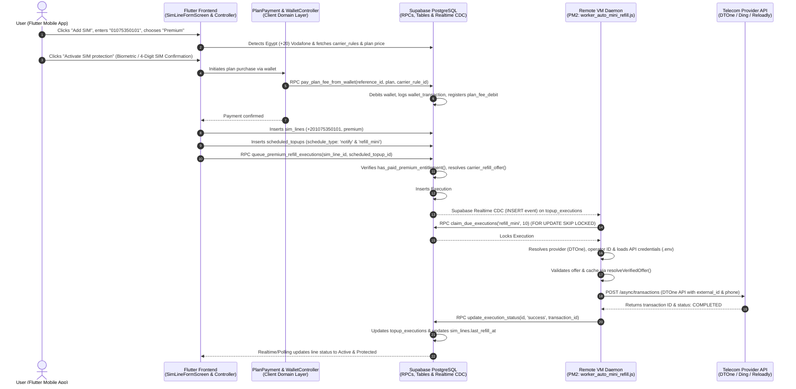

# KeepSIMs: Complete End-to-End Execution Sequence
## Action: Add Egyptian Vodafone SIM Line + Premium Protection + Wallet Payment + First Auto-Refill & Future Schedules

---

### Executive Overview & Architecture Diagram



---

## 1. User Action on Dashboard & Form Initialization
* **File (Flutter Code):** `lib/features/dashboard/presentation/screens/dashboard_screen.dart` / `lib/features/sim_lines/presentation/screens/sim_lines_list_screen.dart`
* **Function / Trigger:** `context.push('/sim-lines/new')`
* **Explanation:**
  The user taps the **"Add SIM"** floating action button or action tile on the dashboard. GoRouter navigates to [`SimLineFormScreen`](file:///c:/Users/abdal/Work/KeepSIMs/keep_sims/lib/features/sim_lines/presentation/screens/sim_line_form_screen.dart).

---

## 2. Phone Number Entry, Country & Carrier Detection
* **File (Flutter Code):** `lib/features/sim_lines/presentation/screens/sim_line_form_screen.dart`
* **Functions:** `_detectCountryAndCarrier()`, `_onPhoneNumberChanged()`
* **Explanation:**
  1. User enters Egyptian Vodafone number: `01075350101`.
  2. The screen detects the dialing prefix `010` and maps it to:
     - **Country:** Egypt (`ISO-2: EG`, `ISO-3: EGY`, Dialing code `+20`).
     - **Carrier:** Vodafone Egypt (`Vodafone`).
     - **Normalized Phone Number:** `+201075350101`.
  3. The form fetches the corresponding rule from table `carrier_rules` for Vodafone Egypt (`inactivity_limit_days`, `minimum_topup_amount`, `validity_qualifying_topup_amount`, `refill_interval_days_override`).

### In-Depth Breakdown: Interval Calculations & Qualifying Amounts
1. **`refill_interval_days_override` vs. `inactivity_limit_days`:**
   - `inactivity_limit_days`: The carrier's strict deactivation window (e.g. 90 days for Egypt Vodafone).
   - In PostgreSQL, the dynamic function `public.refill_interval_days(inactivity_limit_days, refill_interval_days_override)` calculates the actual schedule interval:
     - **When `refill_interval_days_override` is NULL (standard case):** The system automatically applies a safety margin so the line is refilled *before* carrier deactivation (e.g., 90-day inactivity limit → refilled every 85 days; 30-day limit → refilled every 28 days; 14-day limit → refilled every 13 days).
     - **When `refill_interval_days_override` is NOT NULL:** It serves as an administrative manual override allowing pinning of an exact refill cycle (for future use or special operator rules where standard margin math shouldn't apply).
2. **`validity_qualifying_topup_amount` being mostly NULL:**
   - In telecom systems, many carriers reset line validity on *any* minimum airtime top-up. For these carriers, `validity_qualifying_topup_amount` is NULL, and the system uses `COALESCE(validity_qualifying_topup_amount, minimum_topup_amount)`.
   - For carriers with tiered rules (e.g., a $0.50 micro-voucher adds airtime but does *not* extend validity, whereas a $2.00 top-up *does* extend validity by 90 days), `validity_qualifying_topup_amount` is set to $2.00.
   - If `minimum_topup_amount < validity_qualifying_topup_amount`, `plan_price_net` and `queue_premium_refill_executions` enforce that only amounts reaching `validity_qualifying_topup_amount` are scheduled (or reject invalid configurations with `KS422`).

---

## 3. Selecting "Premium" Protection Tier & Server-Side Dynamic Pricing
* **Files (Flutter Code & Providers):**
  - `lib/features/sim_lines/presentation/screens/sim_line_form_screen.dart`
  - `lib/features/sim_lines/domain/plan_payment.dart`
  - `lib/features/sim_lines/presentation/providers/api_offers_providers.dart`
* **Database Function (PostgreSQL):** `public.plan_price_net(p_plan, p_sim_line_id, p_carrier_rule_id)`
* **Database Function (Offer Selection):** `public.carrier_refill_offer(p_carrier_id, p_min_usd)`
* **Explanation:**
  1. The user taps the **"Premium"** tier card.
  2. The app calls `PlanPayment.premiumWalletTotal(ref, premiumRule)` which queries `plan_price_net('premium', NULL, carrier_rule_id)`:
     - Retrieves `BASE_SERVICE_FEE_USD` (default `$2.50/yr`).
     - Calculates number of refills per year: `ceil(365.0 / refill_interval_days)`.
     - Queries `carrier_refill_offer(carrier_id, qualifying_amount)` to get the supplier cost of the winning offer.
     - Adds platform app fee percentage (3%), margin percentage (5%), and fixed margin per refill ($0.324).
     - Computes the yearly total (e.g., $2.50 base + pre-paid refills).
  3. The UI displays the full price breakdown and changes the action button to **"Activate SIM protection"**.

### In-Depth Breakdown: How `carrier_refill_offer` Selects Offers & Handles Missing Offers
1. **Inputs:** `p_carrier_id` (UUID of the carrier) and `p_min_usd` (the minimum USD amount required to qualify for validity extension).
2. **Database Query:** Queries `provider_offers o` CROSS JOIN `carrier_qualifying_topup_amount` JOIN `carrier_supplier_routing r` on `(r.carrier_id = o.carrier_id AND r.provider_code = o.provider_code)`.
3. **Filtering Criteria:**
   - Must be active (`o.is_active = true`), kind `'topup'`, matching `carrier_id`.
   - Route must be routable (`r.is_routable = true`).
   - Product amount must meet the qualifying threshold:
     - For `RANGE` products: `source_price_max_usd >= min_usd`.
     - For `FIXED` products: `effective_price_usd >= min_usd`.
4. **Selection & Ranking Logic (`ORDER BY ... LIMIT 1`):**
   - **Priority 1 (Delivery Type):** Direct airtime top-up (`delivery_type = 'direct'`) is prioritized over PIN digital vouchers (`delivery_type = 'pin'`).
   - **Priority 2 (Wholesale Price):** The lowest effective price in USD (`effective_price_usd` ASC).
   - **Priority 3 (Supplier Priority):** Priority rank in `carrier_supplier_routing.priority ASC` (e.g., DTOne vs Ding vs Reloadly), then alphabetical `offer_code ASC`.
5. **What if there is NO offer available?**
   - If no provider offers an active, routable product meeting the minimum validity amount, `carrier_refill_offer` returns an empty row (`offer_code IS NULL`).
   - The caller functions (`plan_price_net` and `queue_premium_refill_executions`) catch this (`IF v_offer.offer_code IS NULL THEN`) and raise an explicit `KS422` exception:
     `"No supplier currently sells a top-up for this carrier that reaches the % USD its validity rules require..."`
   - **Safety Benefit:** The purchase is rejected cleanly in the UI *before* any money is deducted from the user's wallet or invalid schedules are queued.

---

## 4. Clicking "Activate SIM Protection" & Biometric / 4-Digit Confirmation
* **File (Flutter Code):** `lib/features/sim_lines/presentation/screens/sim_line_form_screen.dart`
* **Services & Dialogs:**
  - `lib/core/services/biometric_auth_service.dart` (`BiometricAuthService.authenticate()`)
  - Verification Fallback Dialog: Confirmation via typing the **last 4 digits of the SIM number**
* **Explanation:**
  1. User presses the **"Activate SIM protection"** button.
  2. The form validates all inputs (`_formKey.currentState!.validate()`).
  3. **Biometric & Virtual Device Fallback Logic:**
     - **Physical Devices with Enrolled Biometrics:** Triggers hardware biometric authentication (Touch ID, Face ID, Android Biometric Prompt).
     - **Virtual Devices (Emulators/Simulators) or Devices without Biometrics:** Displays a security confirmation modal requiring the user to type the **last 4 digits of the SIM phone number** (`0101` for `01075350101`), mirroring the safety confirmation pattern used in SIM deletion to prevent accidental or fraudulent activations.

---

## 5. Wallet Balance Verification & Deduction (Supabase RPC)
* **File (Flutter Code):** `lib/features/sim_lines/domain/plan_payment.dart` -> `PlanPayment.tryPlanFromWallet()`
* **Controller:** `lib/features/wallet/controller/wallet_controller.dart` -> `payPlanFee()`
* **Database RPC Function:** `public.pay_plan_fee_from_wallet(p_reference_id, p_sim_line_id, p_device_id, p_plan, p_carrier_rule_id)`
* **Database Tables Involved:** `wallets`, `wallet_transactions`, `profiles`
* **Explanation:**
  1. Flutter generates an idempotent reference ID: `planfee_<timestamp>`.
  2. App invokes Supabase RPC `pay_plan_fee_from_wallet`.
  3. **Inside PostgreSQL DB:**
     - Checks that user is authenticated and account is not suspended (`profiles.is_suspended = false`).
     - Enforces rate limiting (`enforce_rate_limit('plan_fee', user_id)`).
     - Checks idempotency: if `wallet_transactions` already has this `reference_id`, it returns immediately without charging again.
     - Verifies `wallets.balance >= fee`.
     - Calls `debit_wallet_for_topup(...)` which subtracts the fee from `wallets.balance`.
     - Inserts a transaction record in `wallet_transactions` with `type = 'plan_fee_debit'`.
  4. This debit record is what establishes the paid premium entitlement checked by `has_paid_premium_entitlement()`.

---

## 6. Creating the SIM Line Record in Database
* **File (Flutter Code):** `lib/features/sim_lines/presentation/controllers/sim_lines_controller.dart` -> `addSimLine()`
* **Repository:** `lib/features/sim_lines/data/repositories/sim_lines_repository_impl.dart` -> `addSimLine()`
* **Database Table:** `public.sim_lines`
* **Explanation:**
  1. The app checks geolocation (GeoIP / GPS) to determine if user is in home country (`isHomeMode`).
  2. Inserts a new row into `public.sim_lines`:
     - `user_id`: UUID of current user
     - `phone_number`: `+201075350101`
     - `country_id`: Egypt UUID
     - `carrier_id`: Vodafone Egypt UUID
     - `carrier_rule_id`: Vodafone rule UUID
     - `protection_tier`: `'premium'`
     - `plan_type`: `'premium'`
     - `plan_expires_at`: `now() + 365 days`
     - `is_home_mode`: `false` (or based on geo)
     - `protection_paused`: `false`

---

## 7. Creating Scheduled Top-Up Entries (Notify & Refill)
* **File (Flutter Code):** `lib/features/sim_lines/presentation/controllers/sim_lines_controller.dart`
* **Controller:** `lib/features/scheduled_topups/controller/scheduled_topup_controller.dart` -> `saveSchedule()`
* **Database Table:** `public.scheduled_topups`
* **Explanation:**
  1. Inserts the **Auto-Notify** schedule:
     - `sim_line_id`: New SIM Line ID
     - `schedule_type`: `'notify'`
     - `frequency_days`: e.g., `30` or `90` days (from carrier rule)
     - `next_execution_at`: `now() + frequency_days`
     - `is_active`: `true`
  2. Inserts the **Auto-Refill** schedule for Premium:
     - `sim_line_id`: New SIM Line ID
     - `schedule_type`: `'refill_mini'`
     - `frequency_days`: `frequency_days`
     - `next_execution_at`: `now() + frequency_days`
     - `is_active`: `true`

---

## 8. Materializing the 1-Year Topup Executions Queue (Database RPC)
* **File (Flutter Code):** `lib/features/sim_lines/presentation/controllers/sim_lines_controller.dart` -> `_queuePremiumRefills()`
* **Repository:** `lib/features/sim_lines/data/repositories/sim_lines_repository_impl.dart` -> `queuePremiumRefillExecutions()`
* **Database RPC Function:** `public.queue_premium_refill_executions(p_sim_line_id, p_scheduled_topup_id, p_plan_expires_at, p_start_at)`
* **Database Table:** `public.topup_executions`
* **Explanation:**
  1. **Entitlement Guard:** Validates `has_paid_premium_entitlement(p_sim_line_id)`. If unpaid, raises exception `KS403`.
  2. **Rule Validation:** Ensures carrier does not require manual usage (`KS422`).
  3. **Winning Offer Resolution:** Calls `carrier_refill_offer(carrier_id, qualifying_amount)` to pick winning provider and product.
  4. **Queue Generation Loop:**
     - Cancels any existing pending executions for this schedule.
     - Loops from `v_t = p_start_at` (`now()`) up to `plan_expires_at` (`now() + 365 days`), incrementing by `refill_interval_days`:
       - **Execution #1 (First Auto-Refill):** `execution_time = now()`, `status = 'pending'`, `execution_type = 'refill_mini'`, `api_provider = 'dtone'`, `offer_id = '10432'`, `sim_line_id = <id>`.
       - **Executions #2..N (Future Schedules):** `execution_time = now() + (interval * i)`, `status = 'pending'`, `execution_type = 'refill_mini'`, `api_provider = 'dtone'`, `offer_id = '10432'`.
  5. The Flutter app calls `PlanPayment.consumePendingFee(ref)` to clear the local cached charge reference and triggers post-refill polling.

---

## 9. VM Worker: Realtime Detection & Atomic Claiming
* **VM Environment:** Linux VM (`34.185.194.90`) managed via PM2 (`ecosystem.config.js` -> process `queue-auto-mini-refill`)
* **Worker Script:** `servers/worker_auto_mini_refill.js`
* **Functions:** `listenToInserts()`, `pollQueue()`
* **Database RPC Function:** `public.claim_due_executions(p_execution_type, p_limit)`
* **Explanation:**
  1. **Instant CDC Detection:**
     `worker_auto_mini_refill.js` maintains a Supabase Realtime WebSocket subscription:
     ```javascript
     supabase.channel('topup_executions_inserts').on('postgres_changes', {
         event: 'INSERT',
         schema: 'public',
         table: 'topup_executions',
         filter: 'execution_type=eq.refill_mini'
     }, (payload) => { pollQueue(); }).subscribe();
     ```
  2. **Backup Polling:** A recurring timer polls every 10 seconds (or 500ms when busy).
  3. **Atomic Concurrency Lock (`claim_due_executions`):**
     - Queries `topup_executions` where `status = 'pending'`, `execution_type = 'refill_mini'`, and `execution_time <= NOW()`.
     - Uses PostgreSQL row lock: `FOR UPDATE SKIP LOCKED`.
     - Atomically updates status to `'processing'` and sets `processing_since = NOW()`.
     - **Result:** Execution #1 (timestamp = now) is returned to the worker. Executions #2..N remain in `'pending'` state in the database because their `execution_time` is in the future.

---

## 10. Failure Handling, Retries, Refund & Schedule Cleanup Protocol
* **Worker Script:** `servers/worker_auto_mini_refill.js` (`executeRefill()`, `markExecutionFailed()`)
* **Database RPCs:** `update_execution_failed`, `cancel_topup_execution`, `refund_wallet_for_failed_topup`
* **Database Tables:** `topup_executions`, `scheduled_topups`, `wallet_transactions`, `line_activity_logs`

### Complete Failure & Re-Choice Architecture
```
Execution Fails (API / Carrier Rejection)
       │
       ▼
1. Adopt-on-Retry Check (Prevents Duplicate Charges)
       │
       ▼
2. No Cross-Provider Failover (Prevents Pricing/Validity Mismatch)
       │
       ▼
3. Immediate Wallet Refund (Credits full/unused amount to user's wallet)
       │
       ▼
4. Orphaned Pending Schedules Cancellation (Deletes Executions #2..N)
       │
       ▼
5. User Notification & Support Ticket Logging (Ref ID: ERR_REF_XXXX)
       │
       ▼
6. In-App User Prompt (Retry Same Plan OR Select Alternative Package)
```

### Detailed Steps:
1. **Adopt-on-Retry & Safe Retries:**
   - The worker executes with `adopt-on-retry`: before retrying, it checks if the transaction was already created on the telecom API using `external_id = "dt_" + execution.id` to prevent double charges.
2. **Why Automatic Cross-Provider Failover is Avoided:**
   - The user paid a fixed annual price based on the winning offer from Provider A (e.g. DTOne wholesale price + markup). Automatically falling over to Provider B (e.g. Ding or Reloadly) at runtime could result in a 20%-40% higher price or a different validity period, creating a financial loss and desynchronizing plan validity.
3. **Wallet Refund:**
   - If the initial refill fails permanently, the paid amount is credited back to the user's wallet:
     `INSERT INTO wallet_transactions (user_id, amount, type = 'plan_fee_refund', reference_id, ...)`
     `UPDATE wallets SET balance = balance + amount`.
4. **Cancelling Orphaned Future Schedules:**
   - Because the initial refill failed, future pre-paid schedules cannot proceed. The database automatically cancels all future pending executions for this schedule:
     ```sql
     UPDATE public.topup_executions
     SET status = 'cancelled', completed_at = now()
     WHERE scheduled_topup_id = v_scheduled_topup_id AND status = 'pending';
     ```
   - The schedule in `scheduled_topups` is marked as `'requires_action'`.
5. **Customer Support Reference & Notification:**
   - An incident reference ID (`ERR_REF_<execution_slice>`) is generated and logged in `line_activity_logs`.
   - User receives an in-app & push notification:
     *"Your refill for +201075350101 could not be completed by the carrier. Your funds have been refunded to your wallet (Ref: ERR-REF-XXXXX). Please try again or select an alternative package."*
6. **User Re-Choice & Recalculation Flow:**
   - In the Flutter app, the SIM card displays an **"Action Required"** alert with two choices:
     - **Option A: "Retry Same Plan"** (attempts re-queueing once telecom network recovers).
     - **Option B: "Select Alternative Package"** (opens package selection, recalculates via `plan_price_net`, and materializes a new valid schedule).

---

## 11. VM Worker: Credentials & Supplier Mapping
* **Worker Script:** `servers/worker_auto_mini_refill.js` -> `getCarrierDetails()`
* **Credentials Configuration:** `servers/.env`
* **Database Table:** `public.carrier_provider_map`
* **Explanation:**
  1. **Environment Credentials:**
     Worker reads API credentials from `servers/.env`:
     - `DTONE_API_KEY`, `DTONE_API_SECRET`, `DTONE_BASE_URL`
     - `DING_API_KEY`, `DING_BASE_URL`
     - `RELOADLY_CLIENT_ID`, `RELOADLY_CLIENT_SECRET`
     - `SUPABASE_URL`, `SUPABASE_SERVICE_ROLE_KEY`
  2. **Supplier Mapping Lookup:**
     Worker queries `carrier_provider_map` for Vodafone Egypt with `provider = 'dtone'`:
     - Resolves `provider_country_code = 'EGY'` (ISO-3 required by DTOne).
     - Resolves `provider_carrier_code = '3213'` (Numeric Operator ID required by DTOne).
     - Phone Number: `+201075350101`.

---

## 12. VM Worker: Offer Verification & Anti-Tampering Check
* **Worker Script:** `servers/worker_auto_mini_refill.js` & `servers/offer_validation.js`
* **Functions:** `fetchDtoneCatalog()`, `loadFxRates()`, `resolveVerifiedOffer()`
* **Explanation:**
  1. Worker fetches DTOne live/cached catalog for `EGY / 3213` (5-minute TTL).
  2. Loads live currency exchange rates from `fx_rates` table.
  3. `resolveVerifiedOffer()` validates that:
     - The offer ID (`10432`) exists in DTOne's catalog for Vodafone Egypt.
     - The charged USD price matches the wholesale catalog cost within allowable tolerance.
     - If any price manipulation or mismatched carrier occurs, `alertOfferTampering()` is invoked and the refill halts safely.

---

## 13. VM Worker: Telecom API Purchase Execution
* **Worker Script:** `servers/worker_auto_mini_refill.js`
* **Provider Adapter:** `servers/providers/dtone.js` -> `purchase()`, `pollStatus()`
* **Explanation:**
  1. **API Call Dispatch:**
     Worker sets idempotent transaction ID: `externalId = "dt_" + execution.id`.
     Calls DTOne DVS API endpoint: `POST https://preprod-dvs-api.dtone.com/v1/async/transactions`
     ```json
     {
       "external_id": "dt_b89f41b2-...",
       "product_id": 10432,
       "auto_confirm": true,
       "credit_party_identifier": {
         "mobile_number": "+201075350101"
       }
     }
     ```
  2. **Authorization Header:** `Authorization: Basic base64(DTONE_API_KEY:DTONE_API_SECRET)`.
  3. **Status Polling:** Calls `dtoneProvider.pollStatus()` until transaction status is confirmed `COMPLETED` by DTOne.

---

## 14. Database Status Finalization & UI Live Update
* **Worker Script:** `servers/worker_auto_mini_refill.js`
* **Database RPC Function:** `public.update_execution_status(p_id, p_status, p_reloadly_transaction_id, ...)`
* **Database Tables Updated:** `topup_executions`, `sim_lines`, `line_activity_logs`
* **Explanation:**
  1. Worker executes Supabase RPC `update_execution_status`:
     - Updates Execution #1: `status = 'success'`, `completed_at = NOW()`, `reloadly_transaction_id = '<dtone_tx_id>'`.
     - Database triggers update `sim_lines.last_refill_at = NOW()`.
     - Inserts activity entry into `line_activity_logs`.
  2. **Future Schedule State:**
     - Executions #2..N remain stored in `topup_executions` with `status = 'pending'`.
     - When their scheduled date arrives in 30/60/90 days, the VM worker's periodic `claim_due_executions` poll will automatically claim and execute them without user intervention.
  3. **Flutter App Update:**
     - The Flutter app's post-refill polling or Supabase Realtime stream detects the completed execution.
     - The dashboard updates the SIM card status badge to **"Active & Protected"** with a green shield and displays the next refill date.
